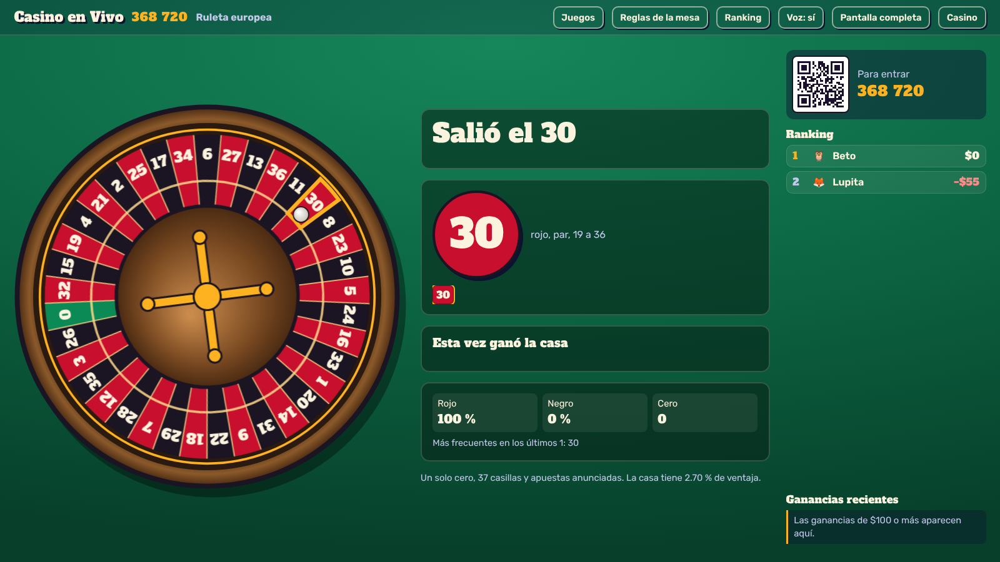

# Casino en Vivo

Casino en modo demo, multijugador y en tiempo real, al estilo Kahoot. El anfitrión abre el casino en la compu o la tele, los jugadores se registran desde su celular escaneando un QR o tecleando un código de 6 números, y cada uno recibe **$1,000 USD ficticios** para usar en todos los juegos.



> **Modo demo.** El dinero es ficticio: no se puede depositar ni retirar y no tiene valor real. La app no maneja pagos.

## Juegos

| Juego | Reglas |
|---|---|
| **Ruleta americana** | 38 casillas (0 y 00). Ventaja de la casa 5.26 % (7.89 % en la apuesta de cinco números). |
| **Ruleta europea** | 37 casillas, un solo cero. Ventaja 2.70 %. Incluye apuestas anunciadas: vecinos del cero, tercio del cilindro, huérfanos, juego cero y vecinos de cualquier número. |
| **Ruleta francesa** | Como la europea, más *La Partage*: si sale cero, recuperas la mitad de tus suertes sencillas (rojo/negro, par/impar, 1-18/19-36). Ventaja 1.35 % en esas apuestas. Nombres en francés en el paño. |
| **Blackjack americano** | 6 barajas. El crupier pide con 17 blando y revisa su carta oculta si muestra As o 10. Blackjack paga 3 a 2, seguro 2 a 1, doblar con dos cartas (también después de dividir), dividir hasta 4 manos. |
| **Blackjack Premium** | El crupier se planta en todos los 17, rendición (recuperas la mitad) y dos apuestas laterales: **Pares perfectos** (par mixto 6 a 1, de color 12 a 1, perfecto 25 a 1) y **21+3** (color 5, escalera 10, trío 30, escalera de color 40, trío del mismo palo 100 a 1). |
| **Videobingo** | 4 cartones de 3×5 que reparten los 60 números, 30 bolas. Doce figuras pagan de 1× (esquinas) a 1,500× (bingo) la apuesta del cartón. Al final se ofrecen hasta 10 bolas extra cuyo precio se calcula con el valor esperado exacto de la siguiente bola más un margen de la casa. |
| **Lotería** | La lotería mexicana de 54 cartas, con todo lo de la app original (tablas 3×3/4×4/5×5, modos de victoria, armar tablas, gritón con voz). Ahora con **costo opcional por tabla**: lo recaudado forma un pozo para quien llene su tabla, y si nadie gana se devuelve. |

Las reglas y pagos de cada juego están comprobados con pruebas automáticas (ver abajo).

## Cómo se juega

1. **El anfitrión** abre `/anfitrion`, decide si se permiten recargas y juegos individuales, y presiona **Abrir casino**. Aparecen un QR y un código.
2. **Cada jugador** escanea el QR o entra a la página y teclea el código, escribe su nombre, elige un avatar y recibe $1,000 ficticios.
3. **Mesa en vivo:** el anfitrión elige un juego y aparece en la tele. Todos apuestan a la vez desde el celular:
   - Ruleta: se gira cuando el anfitrión quiere o sola al terminar el reloj de apuestas.
   - Blackjack: cada quien apuesta y aprieta *Estoy listo*; todos juegan sus manos al mismo tiempo contra el crupier, con reloj para decidir.
   - Videobingo: cada quien compra sus cartones; el sorteo se ve en la tele y luego cada quien decide en su celular si compra bolas extra.
   - Lotería: cada quien elige o arma sus tablas; el gritón canta en la tele.
4. **Juegos individuales:** en la pestaña *Juegos* del celular cada quien puede jugar ruleta, blackjack o videobingo por su cuenta, con el mismo saldo. El anfitrión puede apagar esta opción.
5. **Mi cuenta:** saldo, ganancia neta, lugar en el ranking, movimientos y recarga (si el anfitrión la permite y el saldo baja de $50).
6. Al final, el anfitrión presiona **Terminar y mostrar el podio**. El ranking se ordena por **ganancia neta** (saldo menos lo recibido), así que recargar no ayuda a subir.

En la tele se ven el ranking, las ganancias grandes de cada quien y las reacciones que mandan los jugadores. Atajos del anfitrión: barra espaciadora para girar, repartir, sortear o cantar la siguiente carta; **F** para pantalla completa.

## Instalación

Necesitas [Node.js](https://nodejs.org) 18 o más reciente.

```bash
npm install
npm start
```

Abre `http://localhost:3000/anfitrion` en la compu conectada a la tele. El QR apunta a la dirección de tu red WiFi, así que los celulares que estén en la misma red pueden entrar.

### Publicarla en internet (para jugar a distancia)

GitHub guarda el código, pero no ejecuta servidores Node.js; para publicarla:

1. Sube el contenido de esta carpeta a un repositorio de GitHub (`package.json` y `render.yaml` deben quedar en la raíz).
2. En [Render](https://render.com) entra con tu cuenta de GitHub, elige **New → Blueprint**, conecta el repositorio y presiona **Deploy Blueprint**.
3. Abre `https://TU-SERVICIO.onrender.com/anfitrion`.

En el plan gratuito el servicio se duerme tras 15 minutos sin uso y tarda en despertar; mientras haya jugadores conectados se mantiene activo.

También funciona con Docker (`docker build -t casino . && docker run -p 3000:3000 casino`) o en cualquier servidor con Node.

| Variable | Para qué sirve |
|---|---|
| `PORT` | Puerto del servidor (por defecto 3000). |
| `PUBLIC_URL` | Dirección pública que se pone en el QR, por ejemplo `https://casino.midominio.com`. |

## Pruebas

```bash
npm test
```

Corre tres pruebas:

- **Reglas (`test/reglas.mjs`):** calcula la ventaja exacta de la casa en las 161/157 apuestas de cada ruleta, verifica La Partage y las apuestas anunciadas, totales de blackjack, Pares perfectos y 21+3, simula 120,000 manos de blackjack con estrategia básica y 48,000 rondas de videobingo con y sin bolas extra.
- **Partidas (`test/simulacion.mjs`):** levanta el servidor y juega con varios jugadores conectados por sockets, con resultados forzados para comprobar cada pago al centavo: plenos, docenas, caballo 0-00, La Partage, vecinos, blackjack 3 a 2, seguro, rendición, laterales, dividir y doblar, bingo, bola extra, pozo de lotería, relojes de cada mesa, reconexión con el mismo saldo, ranking, expulsión y podio.
- **Estrés del monedero (`test/dinero.mjs`):** ocho bots hacen decenas de miles de acciones al azar en todas las mesas en vivo e individuales mientras el anfitrión cambia de juego; al final cada saldo debe cuadrar al centavo con sus movimientos y nadie puede quedar en negativo.

## Seguridad y límites

- El servidor decide todo: baraja, giro de la ruleta y sorteo usan el generador criptográfico de Node; el celular solo manda intenciones y el servidor valida saldo, límites y turnos.
- Los montos se manejan en centavos enteros, sin errores de redondeo.
- Las salas viven en memoria: si el servidor se reinicia, se pierden. Una sala sin movimiento por 6 horas se borra sola. Funciona en un solo proceso (para miles de salas habría que agregar un adaptador de Socket.io como Redis).
- Límites por defecto: ruleta $500 por casilla y $5,000 por ronda; blackjack de $5 a $500, laterales hasta $100; videobingo de $0.20 a $10 por cartón.

## Lo que viene de la app de lotería

- `/baraja`: editor de la baraja de lotería (imágenes propias, nombres, versos, reverso, encabezado, voz grabada).
- `/imprimir`: PDF de la baraja con reverso para doble cara y tablas para jugar en papel.

## Estructura

```
server.js                    Servidor HTTP + Socket.io
src/casino.js                Sala: jugadores, monedero, mesa en vivo y juegos individuales
src/juegos/ruleta.js         Mesa de ruleta (las 3 variantes)
src/juegos/blackjack.js      Mesa de blackjack (americano y Premium)
src/juegos/videobingo.js     Videobingo
src/juegos/loteria.js        Lotería con pozo
public/js/shared/            Reglas y pagos compartidos entre servidor y navegador
public/js/tv/                Pantalla del anfitrión
public/js/cel/               Pantalla del jugador
public/js/componentes/       Rueda, paño de ruleta y cartones de bingo
test/                        Pruebas
```
